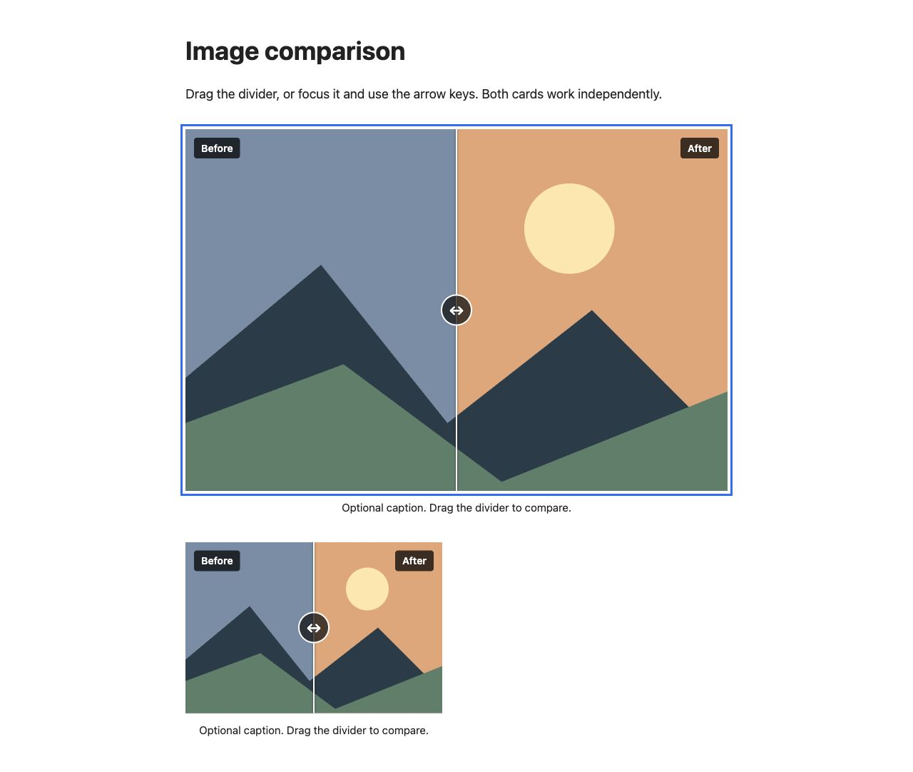

# Ghost Image Comparison

A lightweight before/after image slider for Ghost posts and pages. Save it as a reusable snippet, then pick **Image comparison** from the editor's card menu.

No external scripts, packages, or theme changes are needed.



## Features

- Drag the divider with a mouse or touch.
- Use Tab, arrow keys, Home, and End to compare with a keyboard.
- Custom before/after labels, image descriptions, and an optional caption.
- Responsive sizing and independent sliders on the same page.
- Both images remain available when the script is absent.

## Install once

1. In Ghost, open **Settings → Advanced → Code Injection**.
2. Append all of [`image-comparison/footer-injection.html`](image-comparison/footer-injection.html) to **Site Footer**, keeping any existing code, and save.
3. Open a draft post or page, add an **HTML** card, and paste [`image-comparison/card.html`](image-comparison/card.html).
4. Select the card, click the snippet icon in its toolbar, and save it as **Image comparison**.

Ghost's [snippet documentation](https://ghost.org/help/snippets/) explains how snippets appear in the card menu. This is a reusable HTML card; a new native card with image upload controls would require modifying Ghost's editor.

## Use in a post or page

1. Type `/Image comparison` on a new line, or choose it from the **+** card menu.
2. Replace `BEFORE_IMAGE_URL` and `AFTER_IMAGE_URL` with your image URLs, and write useful `alt` descriptions.
3. Change the `Before` and `After` labels if needed. Edit or remove the `<figcaption>`.
4. Open Ghost's page/post **Preview** to try the slider. Site Footer code runs on the website; the editor canvas may show both images separately.

To get a Ghost image URL, upload an image using a normal Image card, then copy its image address from the preview. Use images with the same framing and aspect ratio: the first image sets the slider's height, and the second fills that area.

The divider starts halfway across. Visitors can drag it with a mouse or touch, or use Tab and the arrow keys, Home, and End. Multiple comparison cards work independently. Without the injected code, the HTML contains both images so they remain readable. Email clients do not run the interactive script.

## Local preview

Clone or download the repository, then run this command from its root:

```sh
python3 image-comparison/preview.py
```

Open <http://127.0.0.1:8937>. Python 3 is only needed for this local preview, which uses the same card and injection files as the installation. Its sample images are generated locally; no network access is needed. Press Ctrl+C to stop the preview server.

## Verification and limitations

Verified in the browser: mouse dragging, Home/End and arrow keys, independent values for multiple cards, a visible keyboard focus outline, and no horizontal overflow at a 390px viewport. No browser warnings or errors occurred. Touch dragging still needs verification on a physical touch device.

The slider has been tested in a local browser preview. Verification in a live Ghost publication is still pending. It is a reusable HTML snippet, so image URLs are edited in HTML rather than through native image upload controls. Interactive comparisons run on the website, not in email newsletters.

## Contributing

Bug reports and improvements are welcome. Include your browser, Ghost version, theme, and steps to reproduce when reporting a problem. For changes, check dragging, keyboard controls, narrow layouts, and multiple cards in the local preview.

## License

[MIT](LICENSE) © 2026 Arda Celik.
